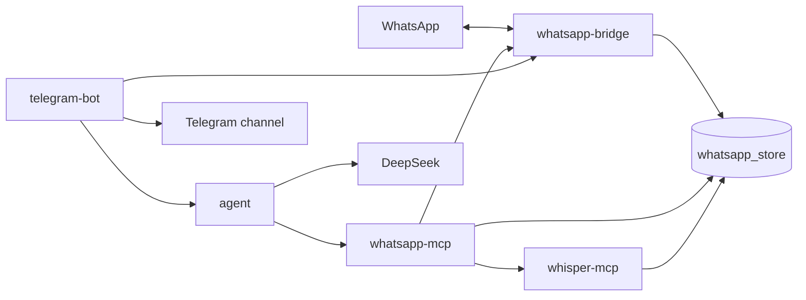

# WhatsApp AI

Personal Docker Compose stack that reads specific WhatsApp groups, transcribes their voice notes locally, asks DeepSeek for a Spanish digest, and posts that digest to a private Telegram channel.

The bridge and the WhatsApp MCP server are derived from [lharries/whatsapp-mcp](https://github.com/lharries/whatsapp-mcp) at commit `7d6a06dcdce1f01dfb24f60e1030d5efba9f3b88`. That code is MIT licensed. Copyright (c) 2025 Luke Harries. See [License](#license).

## License

`whatsapp-bridge/` and `whatsapp-mcp-server/` keep the upstream MIT license, including its copyright and permission notice. Each directory has its own copy: [whatsapp-bridge/LICENSE](whatsapp-bridge/LICENSE) and [whatsapp-mcp-server/LICENSE](whatsapp-mcp-server/LICENSE). [NOTICE](NOTICE) records the upstream repository and commit. Keep those files with any copy or substantial portion of the bridge or the MCP server.

The WhatsApp library used by the bridge is newer than that commit. WhatsApp rejects the March 2025 client with `Client outdated (405)`, so the bridge builds against `go.mau.fi/whatsmeow` `v0.0.0-20261017175727-b2b1e71d45e2`. whatsmeow is downloaded when the image builds. It is not part of this tree and it keeps its own license (MPL-2.0).

## Services

| Service | Role | Published port |
| --- | --- | --- |
| `whatsapp-bridge` | Links the phone, stores chats in SQLite, downloads media | `127.0.0.1:8080` |
| `whatsapp-mcp` | MCP tools, group allowlist, voice-note text | `127.0.0.1:8000` |
| `whisper-mcp` | Local transcription. No host port | none |
| `agent` | Reads MCP text and asks DeepSeek. No host port and no message volume | none |
| `telegram-bot` | Posts to the channel and runs the clock | none |

The bridge and WhatsApp MCP mount the `whatsapp_store` volume at `/data`. Whisper mounts that volume read-only, plus `whisper_models` and `whisper_cache`. The agent does not mount the store, so the only WhatsApp text it can send to DeepSeek is what the WhatsApp MCP returns. The bot keeps its own `bot_state` volume at `/state` and never reads WhatsApp.

The bridge HTTP API has no authentication. Compose publishes the bridge and the WhatsApp MCP only on `127.0.0.1`.



## Workflows

### 1. Link WhatsApp

```bash
cp .env.example .env
docker compose up --build
```

Digest commands fail until `DEEPSEEK_API_KEY` is set. Group choice can wait until WhatsApp is linked.

Open [http://127.0.0.1:8080/](http://127.0.0.1:8080/) and scan the image from WhatsApp: **Settings → Linked devices → Link a device**. The page loads a new code every 15 seconds. A saved screenshot expires and WhatsApp will refuse it. The same code is also printed in `docker compose logs -f whatsapp-bridge`. When the link succeeds, that same page replaces the QR code with the groups on the account.

`GET /health` returns JSON:

- `starting` while the process is opening its databases
- `waiting_for_qr` until the phone is linked
- `connected` after the link succeeds

The PNG is removed once the link succeeds. The session is stored in the volume, so later restarts reconnect without a new QR until WhatsApp expires the linked device (upstream notes this can happen after roughly 20 days). The bridge does not know that expiry date.

WhatsApp sends only a partial history when a device is linked, and that sync can take several minutes. `list_chats` and `list_messages` return only what the bridge has stored.

### 2. Choose the groups

On [http://127.0.0.1:8080/](http://127.0.0.1:8080/), after the phone is linked:

1. The QR code is replaced by the groups on the account, listed by title.
2. Search that list and tick the groups the assistant may read.
3. Save. The page confirms how many groups were stored.

The bridge writes that choice to `allowed-groups.json` on the `whatsapp_store` volume, next to `messages.db`. The file mode is `0600`, and a save replaces it by renaming a temporary file so a restart cannot see a half-written list. The WhatsApp MCP server reads the file on the next request, so the container does not need to be recreated. Saving again replaces the previous choice, including a save with nothing ticked. An empty choice does not mean all chats. No group JID has to be copied into `.env`.

`ALLOWED_GROUP_1`, `ALLOWED_GROUP_2`, and further `ALLOWED_GROUP_<number>` values still work until the first save. Each value is an exact group name or a JID ending in `@g.us`. A blank value is skipped. Once `allowed-groups.json` exists, it is the list the MCP server uses, and the environment variables are ignored. Compose passes `.env` into `whatsapp-mcp` through `env_file`. The other values in that file are present in the container environment as well. An `environment` entry for the same name replaces the file, so leave `ALLOWED_GROUP_*` out of that section.

The bridge page and its group API have no authentication. Compose publishes them only on `127.0.0.1`.

Saving a group also stores its title in `messages.db`, so it can appear in `/grupos` before any new message arrives. `list_chats`, `list_messages`, `count_messages`, `get_chat`, `get_message_context`, `get_last_interaction`, `get_contact_chats`, and `search_contacts` then return only the allowed groups and the people who wrote in them. `get_direct_chat_by_contact` returns nothing. `send_message`, `send_file`, `send_audio_message`, and `download_media` reject every other recipient.

From the host, the MCP endpoint is `http://127.0.0.1:8000/mcp`. From another Compose service, use `http://whatsapp-mcp:8000/mcp`. To run the Python server on the machine instead of in Docker, set `MCP_TRANSPORT=stdio` and point `MESSAGES_DB_PATH` and `WHATSAPP_API_BASE_URL` at the bridge (`http://localhost:8080/api` by default outside Docker).

`check_mcp.py` opens that host endpoint, lists the tool names, and prints `list_chats`. The output includes group names.

### 3. Voice notes

Whisper runs only inside `whisper-mcp`, on CPU, with the `faster-whisper` model named by `WHISPER_MODEL` (default `small`). `WHISPER_LANGUAGE` empty means auto-detect. Weights download once into the `whisper_models` volume. Transcription itself stays on this machine. The model can still write a wrong line for silence, music, or a tone; that text is cached by the SHA-256 of the file.

When `WHISPER_MCP_URL` is set, `list_messages` on an allowed group does this for each voice note (`media_type` `audio`):

1. Download the file through the bridge into `/data`.
2. Ask Whisper to transcribe that path. The path must be a real file under `/data`. A symlink that leaves `/data` is refused.
3. Replace the placeholder with the transcript. A caption on the note is kept after the transcript.

`list_chats` previews do not transcribe. Images, video, and documents stay as placeholders. If the download or the transcription fails, the line stays `[audio - Message ID: ... - Chat JID: ...]` and the rest of the conversation is still returned. A later digest reuses the transcript cache.

### 4. Manual digest

Create a bot with [@BotFather](https://t.me/BotFather) and copy the token into `TELEGRAM_BOT_TOKEN`. Create a private channel, add the bot as an administrator, and allow it to post. Put the channel id in `TELEGRAM_CHANNEL_ID`. That id looks like `-1001234567890`. One way to see it is to forward a channel post to [@userinfobot](https://t.me/userinfobot), or to read `chat.id` from `getUpdates` after posting in the channel.

`TELEGRAM_ALLOWED_USER_IDS` is optional. When it is set, only those Telegram user ids can run the commands.

In a private chat with the bot, or as a post in the channel:

- `resumen-diario` or `/resumen_diario` asks for the daily digest of every allowed group.
- `resumen-semanal` or `/resumen_semanal` asks for the weekly digest.
- The same command followed by a group name asks for that group only. The name is the rest of the message, so spaces are allowed. A JID also works.
- `/grupos`, or the plain word `grupos`, lists the allowed group names.

Telegram does not allow a hyphen in a slash command, so the menu uses the underscore forms. The bot replies that it is asking the agent, then posts one channel message per group, prefixed with the group name. Messages longer than 4096 characters are split. A manual request includes a group that had no messages, as `Sin mensajes.` If the command was not sent in the channel, the bot also confirms there. If the agent fails, the bot replies with that failure and does not post an empty digest.

### 5. Scheduled digests

The clock lives in the bot, in `DIGEST_TIMEZONE` (default `Europe/Madrid`).

- `DIGEST_DAILY_AT` (for example `08:00`) posts the daily digest once that local time has passed. An empty value turns it off.
- `DIGEST_WEEKLY_AT` does the same on Friday. Friday can send both when both times are set.
- A start later that same day still sends the digest once. The weekly job only does this on Friday, so a missed Friday is not sent on Saturday.
- A scheduled run posts one channel message per group that had messages in the window and skips the rest. A manual request still includes the empty groups as `Sin mensajes.`
- A failed run posts the error to the channel and does not mark the day done, so a later check can retry.
- `daily_sent_on` and `weekly_sent_on` are stored in `/state/bot-state.json` on the `bot_state` volume, so a restart does not post the same digest twice.

The bot waits up to 900 seconds for one digest. The first run that contains new voice notes can take a while.

### 6. Message burst

Every 30 seconds the bot wakes up. It counts messages only after `MESSAGE_BURST_INTERVAL_MINUTES` (default 15). The first check stores the current time and does not alert, so startup does not count the whole history.

Each later check calls `POST /activity` with the timestamp of the previous check. The agent asks the MCP server for `count_messages` on each allowed group. That tool is a SQL `COUNT` after the timestamp. It does not download audio and it does not call Whisper.

When a group has more new messages than `MESSAGE_BURST_THRESHOLD` (default 50), the bot posts one line with the group name and the count. It stays quiet for that group until a later check is back at or under the threshold. `0` disables the alert.

### 7. Logged-out WhatsApp

Every minute the bot calls `WHATSAPP_HEALTH_URL` (default `http://whatsapp-bridge:8080/health`). The first time the status is not `connected`, it posts once that WhatsApp must be linked again from the QR page. When the status returns to `connected`, it clears that latch so the next logout can notify again.

## Agent

The agent is the only caller of the WhatsApp MCP server and of DeepSeek. It does not open `messages.db`, it does not call Whisper, and it does not hold the Telegram token. Inside Compose it listens on port 8081 with no host port. `MCP_URL` defaults to `http://whatsapp-mcp:8000/mcp`.

`daily` starts at local midnight in `DIGEST_TIMEZONE`. `weekly` starts at that midnight seven days earlier. The agent pages `list_chats` until every allowed group is included. For each selected group it pages `list_messages` with `include_context` false, newest first, 100 messages per page, at most 500 messages and 80,000 characters. Older messages beyond that cap are omitted and the summary says so.

Each group with text gets its own DeepSeek call (`DEEPSEEK_API_KEY`, `DEEPSEEK_BASE_URL`, `DEEPSEEK_MODEL`). The prompt asks for one Spanish summary, treats a transcript as normal conversation, and forbids inventing the words of a leftover `[audio]` placeholder. A group with no messages returns `empty: true` and the fixed line `Sin mensajes.` without calling DeepSeek. An unknown group is HTTP 404. A missing DeepSeek key is HTTP 503, before any MCP call.

`POST /digests`:

```json
{"period": "daily", "group": "optional name or jid"}
```

Omit `group` to include every allowed group. Success is HTTP 200:

```json
{"groups": [{"name": "Alpha", "text": "the digest", "empty": false}]}
```

Any other failure:

```json
{"error": "reason"}
```

`GET /groups` returns the names and JIDs from `list_chats`. `POST /activity` with `{"since": "ISO-8601"}` returns `{"groups": [{"name": "Alpha", "jid": "...@g.us", "count": 7}]}`.

## Configuration

Copy [.env.example](.env.example) to `.env`. Compose reads that file for the values below. After a change, recreate the service that uses it.

| Variable | Used by | Meaning |
| --- | --- | --- |
| `BRIDGE_PORT`, `MCP_PORT` | Compose | Host ports, bound to `127.0.0.1` |
| `ALLOWED_GROUP_1`, `ALLOWED_GROUP_2`, … | WhatsApp MCP | Optional fallback until a selection is saved on the bridge page |
| `WHISPER_MCP_URL`, `WHISPER_MODEL`, `WHISPER_LANGUAGE`, `WHISPER_DEVICE` | WhatsApp MCP and Whisper | Local transcription |
| `DEEPSEEK_API_KEY`, `DEEPSEEK_BASE_URL`, `DEEPSEEK_MODEL` | Agent | Digest model |
| `DIGEST_TIMEZONE` | Agent and bot | Window and clock, default `Europe/Madrid` |
| `TELEGRAM_BOT_TOKEN`, `TELEGRAM_CHANNEL_ID` | Bot | Required. The bot must be a channel admin |
| `TELEGRAM_ALLOWED_USER_IDS` | Bot | Optional comma-separated user ids |
| `AGENT_URL` | Bot | Default `http://agent:8081` |
| `DIGEST_DAILY_AT`, `DIGEST_WEEKLY_AT` | Bot | Local `HH:MM`. Empty disables that job |
| `MESSAGE_BURST_INTERVAL_MINUTES`, `MESSAGE_BURST_THRESHOLD` | Bot | Default 15 and 50. Threshold `0` disables the alert |
| `WHATSAPP_HEALTH_URL` | Bot | Default `http://whatsapp-bridge:8080/health` |

```bash
docker compose up -d --build
```
